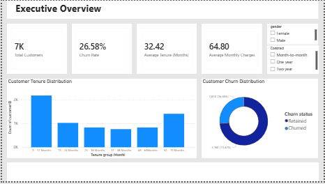
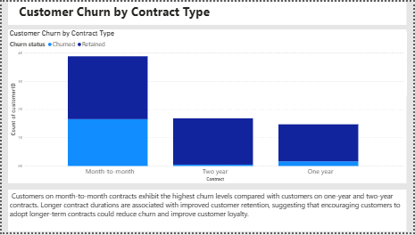
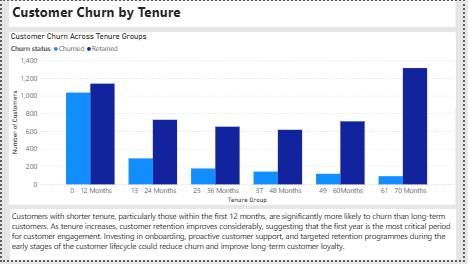
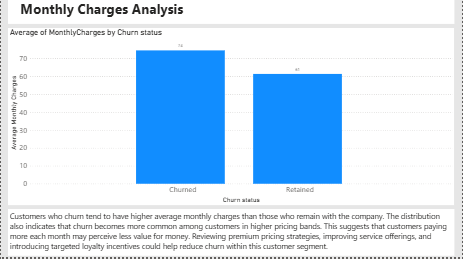

# **Telco Customers Churn**

# Project Overview  
This project analyses customer data from a telecommunications company to identify key factors driving customer churn and to build a machine learning model capable of predicting churn.

# 
  
## Dataset Content
* Telco Customer Churn Dataset
Source: IBM Sample Dataset (Kaggle)

The dataset contains approximately 7,000 customer records with features including:

- Demographics
- Contract information
- Services subscribed
- Monthly charges
- Tenure
- Target variable: Churn

## Business Requirements
* The goal of this project is to analyse telecom customer data to understand the key factors that influence customer churn and develop a predictive model that identifies customers at risk of leaving the service.

- The specific business requirements are:
- Identify the main factors that contribute to customer churn.
- Analyse customer behaviour patterns related to contract type, tenure, and monthly charges.
- Develop a machine learning model capable of predicting customer churn.
- Present actionable insights through visualisations and dashboards to support business decision-making.
- Provide an interactive dashboard that allows stakeholders to explore churn patterns.

## Hypothesis and how to validate?
* Hypothesis 1

Customers with month-to-month contracts are more likely to churn than customers with long-term contracts.

Validation Method:
A Chi-Square test of independence will be performed to determine whether there is a statistically significant relationship between contract type and churn.

* Hypothesis 2

Customers with shorter tenure are more likely to churn than long-term customers.

Validation Method:
An Independent T-Test will compare the average tenure between churned and retained customers.

* Hypothesis 3

Customers with higher monthly charges are more likely to churn.

Validation Method:
A T-Test will compare the monthly charges between churned and non-churned customers.

## Project Plan
*The project followed a structured data analytics workflow consisting of:

+ Data Collection – The Telco Customer Churn dataset was sourced from a publicly available dataset.
+ Data Cleaning and Transformation – The data was cleaned, formatted, and prepared for analysis.
+ Exploratory Data Analysis – The dataset was analysed to identify patterns and relationships.
+ Data Visualisation – Graphical representations were created to communicate insights clearly.
+ Statistical Testing – Hypothesis testing was performed to validate findings.
+ Machine Learning – Predictive models were developed to forecast churn.
+ Dashboard Development – A visual dashboard was created for stakeholders.
  
*  Data Management 
Data was managed through the following stages:

+ Collection - The dataset was downloaded and stored in the project’s dataset/raw folder.
+ Processing - Data cleaning and transformations were performed in the ETL notebook. Missing values and incorrect data types were addressed.
+ Analysis -The cleaned dataset was analysed through exploratory data analysis and statistical testing.
+ Interpretation - Insights derived from analysis were visualised using charts and dashboards.
+ The cleaned dataset was stored in dataset/processed/cleaned_telco.csv to ensure reproducibility.
  
* Research methodologies used
  The following methodologies were used:

- Exploratory Data Analysis (EDA) to understand the dataset structure and patterns.
- Statistical hypothesis testing to validate observed relationships.
- Machine learning classification models to predict churn outcomes.

These methodologies were selected because they provide both descriptive and predictive insights, which are valuable for business decision-making.

## Analysis techniques used

The following techniques were used:

- Descriptive Statistics
- Correlation Analysis
- Chi-Square Test
- Independent Samples T-Test
- Logistic Regression
- Random Forest (comparison model)
  
* The data analysis was structured in the following order:

- Data cleaning and transformation
- Exploratory analysis
- Visualisation of patterns
- Statistical validation
- Predictive modelling

This structure ensures that insights are validated before building predictive models.

* Data Limitations
  Some limitations of the dataset include:
- Limited behavioural variables
- Potential imbalance in churn classes

Alternative approaches could include:
- Random Forest or Gradient Boosting models
- Feature selection techniques
- Cross-validation for improved model robustness
  
* Generative AI Usage
  Generative AI tools were used to assist with:
- Project planning and ideation
- Code optimisation
- Debugging Python scripts
- Structuring documentation
  
## Ethical considerations
* Data Privacy - The dataset used is publicly available and contains no personally identifiable information.
* Bias and Fairness - Potential bias may exist in customer demographics or service usage patterns. Care was taken to avoid making discriminatory assumptions based on the data.

  ## Dashboard Design
* The dashboard was designed to:
* Support both technical and non-technical stakeholders.
* Present clear business insights.
* Enable interactive filtering.
* Provide consistent navigation.
* Translate analytical findings into actionable recommendations.

  ### Dashboard Pages 

The final dashboard was developed entirely in Microsoft Power BI.

The dashboard is designed for business stakeholders and enables interactive exploration of customer churn patterns.

Dashboard Pages
Page 1 – Executive Overview

Provides a high-level summary including:
* Total Customers
* Churn Rate
* Average Tenure
* Average Monthly Charges
* Customer Churn Distribution

Page 2 – Contract Analysis

Explores the relationship between contract type and customer churn. 
Visualisations include:

* Customer Churn by Contract Type

Page 3 – Tenure Analysis

Investigates how customer tenure influences churn.
Visualisations include:

Customer Churn Across Tenure Groups

Page 4 – Monthly Charges Analysis

Examines the relationship between monthly charges and customer churn.
Visualisations include:

Average Monthly Charges by Churn Status

During development, the tenure column was replaced with the tenure_group feature in visualisations because grouped tenure ranges provide clearer and more interpretable insights for users.

## Main Data Analysis Libraries
* Pandas – data loading and manipulation
Example:
df = pd.read_csv("Telco-Customer-Churn-Cleaned.csv")
* NumPy – numerical operations.
* Scikit-learn – machine learning model training and scaling.
* Joblib – loading the trained model and scaler.
* Power BI – building the interactive dashboard.

## Learning Journey

This project has given me a hands-on experience in building a complete data science project from data analysis, to developing a machine learning model, and deploying a dashboard - the entire workflow basically. In this journey, i've consolidated my knowledge on cleaning data (the ETL process) and getting it ready for analysis, feature engineering, and model evaluation using Python libraries such as Pandas and Scikit-learn. I have also strenthened my skills in data and statistical analysis and visualisations, upon which i can obtain insights that that can be shared with diverse stakeholders.

Developing the Power BI dashboard enhanced my ability to communicate analytical findings to non-technical stakeholders through interactive visualisations and business-focused storytelling. The project also reinforced the importance of selecting appropriate analytical techniques, validating findings statistically, and translating technical results into actionable business recommendations.
The original Streamlit deployment experienced technical issues, making the dashboard inaccessibie. To ensure reliable access and improve stakeholder usability, interactive dashboards were developed using Power Bl.

## Credits
* Dataset from the IBM Telco Customer Churn dataset
* Documentation from Pandas, Scikit-learn, Streamlit
* LMS
* Generative AI (Copilot, ChatGPT)
* Github 

## Acknowledgements 
Many thanks to Vasi, Mark and my colleagues who have been instrumental to the successful completion of this project